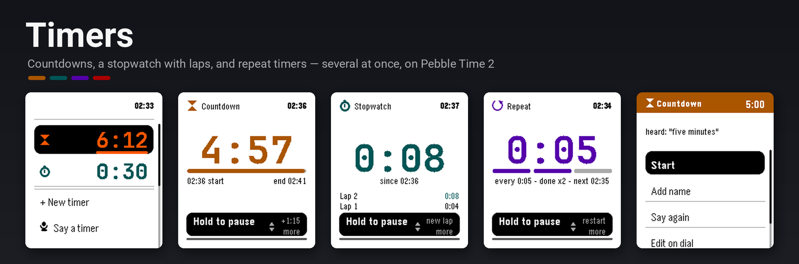

# Timers

Countdown, stopwatch-with-laps, and repeat interval timers for **Pebble Time 2**,
with multiple live timers, saved presets, and “Say a timer” voice entry.

**Free · Pebble Time 2 (`emery`) · current PebbleOS · not compatible with Round 2 or older Pebbles**

**[Get Timers, see screenshots, and install it from the rePebble store](https://apps.repebble.com/5673ae9a96914ac297bfec85)**



## A note from the human (this note, like the app, was written by an AI)

Depending on a project's characteristics I decide how involved to be, from carefully reviewing every
line to a single-request vibe-code, and everywhere in between.

For Timers I was near the hands-off end: I set the product, design, and technical direction but did
not review the code. It was built by AI agents, Claude and Codex, working to that direction and
reviewing each other's work.

## What it does

**Across the app**

- Run several at once; the home screen keeps each live time visible.
- Say a timer by voice, in English or Spanish ("five minutes", "pasta for eight minutes",
  "every 20 minutes", "at 6:45").
- Save up to 12 presets and start one with a press.
- Timers keep their deadline even when the app is closed, and re-alert with snooze when one finishes.

**Countdowns**

- Big digits with a progress bar.
- Start and end time shown.
- Hold to pause.
- Add more time while it runs.
- Keep counting past zero.

**Stopwatch**

- Laps right on the main screen.
- Hold to add a lap.

**Repeat timers**

- Repeat on a set interval.
- Visible round tally.
- Quick restart.

You can also name any timer and turn a countdown into a repeat.

Timers is for Pebble Time 2 owners who want countdowns, stopwatch sessions, and intervals in one
place, whether that is for cooking, workout rests, focus blocks, or other everyday timing. It is
designed for short, glanceable watch interactions: the current time stays prominent, relevant
button actions remain visible, holds show progress before committing, and the layout adapts from a
single large timer to a compact multi-timer list.

## Build and develop

Timers is a native C app built with Pebble SDK 4.17. Clone the repository with its submodule, then
use the setup script to install and verify the local toolchain:

```sh
git clone --recurse-submodules https://github.com/Persitz/pebble-timers.git
cd pebble-timers
./app/scripts/setup.sh
```

Build the watch app:

```sh
cd app
pebble build
```

The resulting bundle is written to `app/build/app.pbw`. From `app/`, the main local checks are:

```sh
npm run test:c
npm run size:c
../harness/bin/emu-verify.sh --build --out emulator-runs/screenshot.png
```

The host tests exercise the app's platform-independent C logic. The public CI covers those tests,
the watch build, and the binary-size gate; the emulator command above is the documented manual
smoke test. `harness/` is a git submodule used for emulator testing.

Built and tested with [pebble-testpilot](https://github.com/Persitz/pebble-testpilot).

## Source and license

Timers is open source under the [Apache License 2.0](LICENSE). Third-party notices are in
[NOTICE](NOTICE), with the JetBrains Mono license alongside the font at
[`app/resources/fonts/OFL.txt`](app/resources/fonts/OFL.txt).

Found a bug or have feedback? Please open an issue (bugs, feedback, and feature ideas are all
welcome). This repository is a source mirror, so I don't take pull requests here. For
security-sensitive reports, use GitHub's private vulnerability reporting rather than a public issue.
